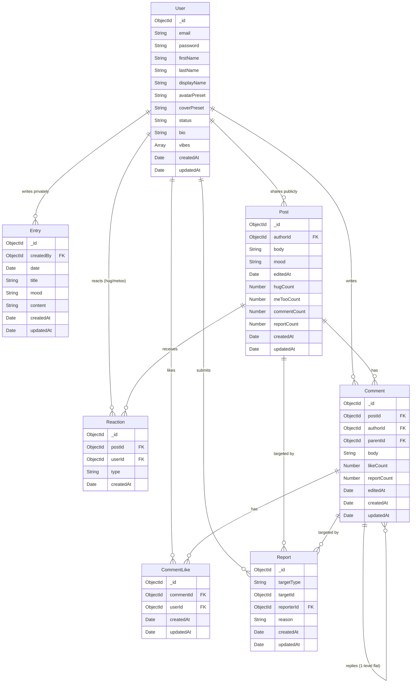

# DayBook Architecture & Privacy Design

## 1. System Overview

DayBook is a peer-support journal and social web application built with a modern decoupled stack:
- **Frontend**: React 19, Redux Toolkit & RTK Query, React Router v7, Tailwind CSS v4, Lucide/React Icons
- **Backend**: Node.js, Express 4, Mongoose 8 (MongoDB)
- **Authentication**: JWT stored in httpOnly, secure cookies, verified on every protected request

---

## 2. Data Model

### Collections Overview



### Models & Schema Specifications

#### User (`users` collection)
- `email`: String, required, unique
- `password`: String (bcrypt hashed)
- `firstName`: String, required
- `lastName`: String
- `displayName`: String, optional custom alias
- `avatarPreset`: String, preset identifier (default: "initials")
- `coverPreset`: String, preset gradient/image identifier

#### Entry (`entries` collection) — **Strictly Private**
- `createdBy`: ObjectId (ref: User), required
- `date`: Date, required
- `title`: String, max 20 chars
- `mood`: String enum (`["🙂", "😌", "😔", "😡", "🌱", "✨"]`)
- `content`: String, max 1500 chars
- Timestamps: `createdAt`, `updatedAt`

#### Post (`posts` collection) — **Public Feed**
- `authorId`: ObjectId (ref: User), required
- `body`: String, max 1000 chars, plain text trimmed
- `mood`: String enum (`["🙂", "😌", "😔", "😡", "🌱", "✨"]`)
- `editedAt`: Date, default `null`
- `hugCount`: Number, default 0
- `meTooCount`: Number, default 0
- `commentCount`: Number, default 0
- `reportCount`: Number, default 0
- Timestamps: `createdAt`, `updatedAt`
- **Indexes**:
  - `{ createdAt: -1 }` (feed reverse chronological sorting)
  - `{ authorId: 1, createdAt: -1 }` (user's post history)

#### Reaction (`reactions` collection) — **Stage 2**
- `postId`: ObjectId (ref: Post), required
- `userId`: ObjectId (ref: User), required
- `type`: String enum (`["hug", "metoo"]`), required
- Timestamps: `createdAt`
- **Indexes**:
  - `{ postId: 1, userId: 1, type: 1 }` (Unique: prevents duplicate reactions)
  - `{ postId: 1, type: 1 }`

#### Comment (`comments` collection) — **Stage 2**
- `postId`: ObjectId (ref: Post), required
- `authorId`: ObjectId (ref: User), required
- `parentId`: ObjectId (ref: Comment), default `null` (replies flatten to top-level parent so discussions stay strictly 1 level deep)
- `body`: String, max 500 chars, plain text trimmed
- `likeCount`: Number, default 0, min 0
- `reportCount`: Number, default 0
- `editedAt`: Date, default `null`
- Timestamps: `createdAt`, `updatedAt`
- **Indexes**:
  - `{ postId: 1, parentId: 1, createdAt: 1 }`
  - `{ authorId: 1 }`

#### CommentLike (`commentlikes` collection) — **Stage 2**
- `commentId`: ObjectId (ref: Comment), required
- `userId`: ObjectId (ref: User), required
- Timestamps: `createdAt`, `updatedAt`
- **Index**: `{ commentId: 1, userId: 1 }` (Unique: idempotent likes)

#### Notification (`notifications` collection) — **Stage 3**
- `recipientId`: ObjectId (ref: User), required
- `actorId`: ObjectId (ref: User), required
- `type`: String enum (`["post_hug", "post_metoo", "post_comment", "comment_reply", "comment_like"]`), required
- `postId`: ObjectId (ref: Post), required
- `commentId`: ObjectId (ref: Comment), default `null`
- `read`: Boolean, default `false`
- `createdAt`: Date, default `Date.now`
- **Indexes**:
  - `{ recipientId: 1, read: 1, createdAt: -1 }` (unread count and fast list retrieval)
  - `{ recipientId: 1, createdAt: -1 }`
  - `{ recipientId: 1, actorId: 1, type: 1, postId: 1, commentId: 1 }` (Unique: deduplicates interactions)
  - `{ createdAt: 1 }`, TTL `expireAfterSeconds: 5184000` (auto-deletes after 60 days)

#### Report (`reports` collection) — **Safety & Moderation**
- `targetType`: String enum (`["post", "comment"]`)
- `targetId`: ObjectId, required
- `reporterId`: ObjectId (ref: User), required
- `reason`: String, max 500 chars
- Timestamps: `createdAt`, `updatedAt`
- **Index**: Compound unique `{ reporterId: 1, targetType: 1, targetId: 1 }` to prevent duplicate reports by the same user on the same target.

---

## 3. The Privacy Boundary: Entries vs. Posts

A core tenet of DayBook is guaranteeing absolute confidentiality for personal journal entries while offering a public peer-support feed and discussion.

### Complete Separation of Concerns
1. **Separate Collections**:
   - `entries`, `posts`, and `comments` are completely distinct MongoDB collections.
   - Journal entries are never queried, joined, or populated in any feed or comment route.
   - Public posts and comments never query or reference the `entries` collection.
2. **Distinct Creation Paths**:
   - Choosing **"Private journal (only me)"** writes exclusively to `POST /api/entries`.
   - Choosing **"Public (everyone)"** writes exclusively to `POST /api/posts`.
   - Default audience is always **Private**. Switching to Public requires an explicit user choice.
3. **No Automatic Sharing or Migration**:
   - Private entries cannot leak into the feed or discussions.
   - Existing private journal entries remain strictly scoped to `req.user._id`.

---

## 4. Serializer Allowlist

To eliminate data leakage risks, raw Mongoose documents are **never** returned directly in public responses. Every public response passes through explicit allowlist serializers (`backend/src/utils/serializers.js`).

### Public Author Allowlist
```javascript
const serializeAuthor = (user) => {
  if (!user) return null;
  return {
    _id: user._id,
    displayName: user.displayName || `${user.firstName || ""} ${user.lastName || ""}`.trim(),
    username: user.firstName || "User",
    avatarPreset: user.avatarPreset || "initials",
  };
};
```

### Public Post Allowlist
```javascript
const serializePost = (post, authorDoc, viewerFlags = {}) => {
  return {
    _id: post._id,
    author: serializeAuthor(authorDoc),
    body: post.body,
    mood: post.mood || null,
    createdAt: post.createdAt,
    editedAt: post.editedAt || null,
    hugCount: post.hugCount || 0,
    meTooCount: post.meTooCount || 0,
    commentCount: post.commentCount || 0,
    viewerHasHugged: Boolean(viewerFlags.viewerHasHugged),
    viewerHasMeToo: Boolean(viewerFlags.viewerHasMeToo),
  };
};
```

### Public Comment Allowlist
```javascript
const serializeComment = (comment, authorDoc, viewerFlags = {}, replies = [], replyCount = 0) => {
  return {
    _id: comment._id,
    postId: comment.postId,
    author: serializeAuthor(authorDoc),
    parentId: comment.parentId || null,
    body: comment.body,
    likeCount: comment.likeCount || 0,
    viewerHasLiked: Boolean(viewerFlags.viewerHasLiked),
    replyCount: replyCount,
    replies: replies,
    createdAt: comment.createdAt,
    editedAt: comment.editedAt || null,
  };
};
```

### Strictly Forbidden from Public Responses
- `email`
- `password`
- JWT tokens
- User private entries / journal history
- User settings or internal timestamps
- `reportCount` (kept internal to prevent target awareness/harassment)

---

## 5. Threat Model & Safety Mitigations

| Threat / Risk | Impact | Mitigation in DayBook |
| :--- | :--- | :--- |
| **Private Data Leakage** | User's private reflections or email visible to public | Two distinct collections (`entries` vs `posts`). Explicit allowlist serializers pick only safe fields (`_id`, `displayName`, `username`, `avatarPreset`). Verified with automated tests. |
| **IDOR / Unauthorized Post Tampering** | User A edits or deletes User B's post | Ownership check enforced server-side on both `PATCH /api/posts/:id` and `DELETE /api/posts/:id`. Mismatched `authorId` yields a `403 Forbidden` response. |
| **Unauthorized Comment Deletion** | User A deletes User B's comment | Comment deletion permitted only for comment author OR post author. Unauthorized callers receive `403 Forbidden`. |
| **Cascade Deletions** | Orphaned comments, likes, or reactions after post deletion | `deletePost` cascades and cleans up all related `Reaction`, `Comment`, `CommentLike`, and `Report` records. Similarly, deleting a comment cleans up its replies, likes, reports, and adjusts `post.commentCount`. |
| **Race Conditions on Reactions / Likes** | Duplicate reactions or counts pushed below zero | Compound unique index `{ postId: 1, userId: 1, type: 1 }`. Only increments if insertion succeeded. Removal only decrements if record deleted and count > 0. Verified by parallel request tests. |
| **Spam / Flood Posting & Commenting** | Feed flooded with automated posts or comments | `express-rate-limit` enforces max 10 posts/hour and 30 comments/hour per user, keyed by `req.user._id`. |
| **Deep Threading Nesting Chaos** | Indefinite nested comments breaking UI | Reply flattening: if a user replies to a reply, `parentId` is automatically set to the top-level parent comment, ensuring 1-level flat threads. |
| **Report Abuse / Brigading** | Bad actor spams reports to overwhelm moderation | Rate limited to 20 reports/hour. Compound unique index `{ reporterId: 1, targetType: 1, targetId: 1 }` rejects duplicates with `409 Conflict`. Self-reporting forbidden. Reports do not auto-hide posts. |
| **XSS (Stored Cross-Site Scripting)** | Malicious HTML/JS injected via post/comment body | User text treated strictly as plain text (no HTML parsing, rendered safely via React text nodes). Server trims and caps body lengths. |
| **Self-Harm / Crisis Content** | User expressing crisis or intent to harm | Client-side non-blocking detection checks against centralized keyword list (`config/crisisKeywords.js`). Displays a gentle banner with crisis helplines. Never blocks posting, never shames, never auto-reports. |
| **Pagination Inconsistencies** | Duplicate or skipped items during infinite scrolling | Cursor pagination using `(createdAt, _id)` comparison instead of fragile offset `skip/limit`. |

---

## 6. Check-in Section & WHO-5 Wellbeing Specification

### Overview
The Check-in section provides private, self-guided mental wellbeing assessments and personality snapshots. It is completely isolated from social features (never creates posts, feeds, or notifications).

### Official WHO-5 Citation & Terms of Use
- **Citation:** World Health Organization Collaborating Centre for Mental Health, Psychiatric Research Unit, Mental Health Centre North Zealand, Hillerød, Denmark (1998).
- **Primary Reference:** Topp, C. W., Østergaard, S. D., Søndergaard, S., & Bech, P. (2015). *The WHO-5 Well-Being Index: A Systematic Review of the Literature.* Psychotherapy and Psychosomatics, 84(3), 167-176.
- **Terms of Use Note:** **Free, no permission needed.** The WHO-5 is in the public domain and can be freely used without permission from the World Health Organization.

### WHO-5 Exact Official Item Wording
Timeframe prompt: *"Please indicate for each of the five statements which is closest to how you have been feeling over the last two weeks."*

1. **"I have felt cheerful and in good spirits"**
2. **"I have felt calm and relaxed"**
3. **"I have felt active and vigorous"**
4. **"I have felt fresh and rested when waking up"**
5. **"My daily life has been filled with things that interest me"**

### Scoring Scale (0 to 5)
- `5`: All of the time
- `4`: Most of the time
- `3`: More than half of the time
- `2`: Less than half of the time
- `1`: Some of the time
- `0`: At no time

### Scoring Rules (Server-Side)
- $\text{Raw Score} = \sum_{i=1}^{5} \text{item}_i \in [0, 25]$
- $\text{Percentage Score} = \text{Raw Score} \times 4 \in [0, 100]$
- **Cutoff:** $\text{Raw Score} < 13$ (or $\text{Percentage Score} < 50$) indicates low well-being and is flagged for depression risk.
- **Bands:**
  - $\text{Raw} < 13$: *"Low well-being"* (`flaggedLow: true`)
  - $\text{Raw} \ge 13 \land \text{Score} < 70$: *"Moderate well-being"* (`flaggedLow: false`)
  - $\text{Score} \ge 70$: *"Good well-being"* (`flaggedLow: false`)

### Privacy & Data Boundary
- **Individual answers are NEVER persisted** to MongoDB. They are evaluated in-memory on `POST /api/checkins` and discarded immediately.
- Only the aggregated `score`, `rawScore`, `band`, `flaggedLow`, `type`, and `createdAt` are saved.
- **Rate Limit & Frequency:** Maximum 1 saved check-in per calendar day per user. API rate-limited to 10 requests/hour.
- **Strict Isolation:** Check-in records are completely inaccessible via any public endpoint, feed, or profile query. All endpoints require authentication and filter strictly by `req.user._id`. Users can purge their entire check-in history via `DELETE /api/checkins/me`.

---

## 7. Personality Snapshot (Mini-IPIP Big Five) Specification

### Overview
The Personality Snapshot is a 20-item short measure of the Big Five personality factors, adapted from the International Personality Item Pool (IPIP).

### Official Citation & Terms of Use
- **Citation:** Donnellan, M. B., Oswald, F. L., Baird, B. M., & Lucas, R. E. (2006). *The Mini-IPIP Scales: Tiny-yet-effective measures of the Big Five factors of personality.* Psychological Assessment, 18(2), 192–203. https://doi.org/10.1037/1040-3590.18.2.192
- **Terms of Use Note:** **Public Domain.** All items in the International Personality Item Pool are in the public domain and may be used without permission or fee.

### 20 Items and Scoring Key
Scale: 1 ("Very Inaccurate") to 5 ("Very Accurate").
Reverse items are scored using: $x_{\text{scored}} = 6 - x$.

| Item # | Text | Trait | Key |
|---|---|---|---|
| 1 | "Am the life of the party." | Extraversion | + |
| 2 | "Sympathize with others' feelings." | Agreeableness | + |
| 3 | "Get chores done right away." | Conscientiousness | + |
| 4 | "Have frequent mood swings." | Neuroticism | + |
| 5 | "Have a vivid imagination." | Openness | + |
| 6 | "Don't talk a lot." | Extraversion | - (Reverse) |
| 7 | "Am not interested in other people's problems." | Agreeableness | - (Reverse) |
| 8 | "Often forget to put things back in their proper place." | Conscientiousness | - (Reverse) |
| 9 | "Am relaxed most of the time." | Neuroticism | - (Reverse) |
| 10 | "Am not interested in abstract ideas." | Openness | - (Reverse) |
| 11 | "Talk to a lot of different people at parties." | Extraversion | + |
| 12 | "Feel others' emotions." | Agreeableness | + |
| 13 | "Like order." | Conscientiousness | + |
| 14 | "Get upset easily." | Neuroticism | + |
| 15 | "Have difficulty understanding abstract ideas." | Openness | - (Reverse) |
| 16 | "Keep in the background." | Extraversion | - (Reverse) |
| 17 | "Am not really interested in others." | Agreeableness | - (Reverse) |
| 18 | "Make a mess of things." | Conscientiousness | - (Reverse) |
| 19 | "Seldom feel blue." | Neuroticism | - (Reverse) |
| 20 | "Do not have a good imagination." | Openness | - (Reverse) |

### Dimension Ranges & Non-Diagnostic Framing
- Each trait produces an integer score from **4 to 20**.
- **Framing:** Always presented using friendly, tentative language ("Tends toward...") rather than diagnostic labels.
- **Disclaimer:** *"Personality is nuanced; this is a short, fun snapshot. These scores reflect broad behavioral tendencies, not fixed limits or clinical categories."*
- **Celebration:** Successfully saving a snapshot dispatches a custom event to trigger cheerful pet reactions on the playground.
- **Privacy Boundary:** Raw answers are discarded immediately. Only the 5 trait scores are stored in `checkins` with `type: "mini_ipip"`.


